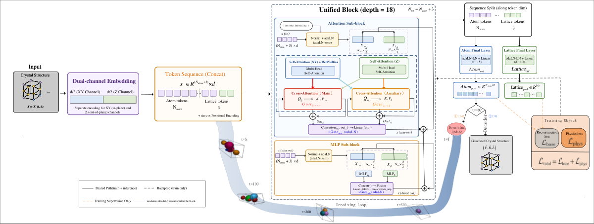
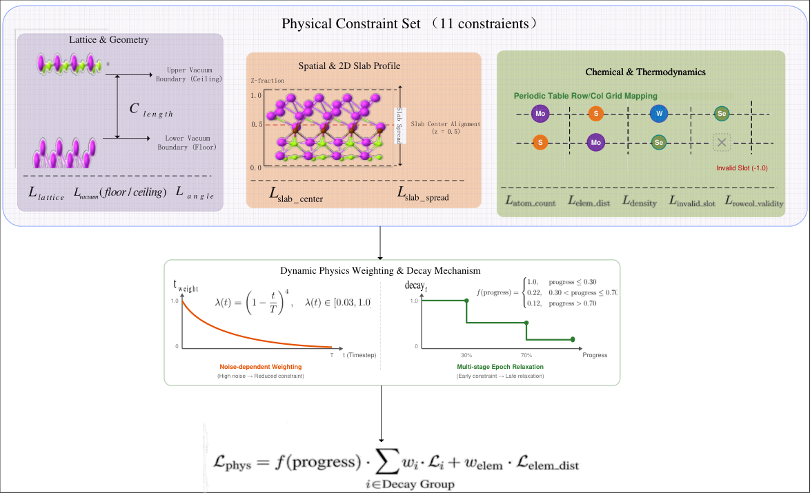
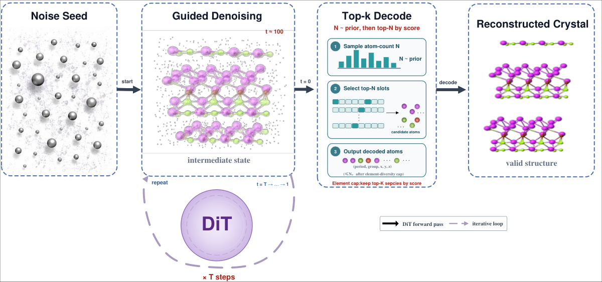
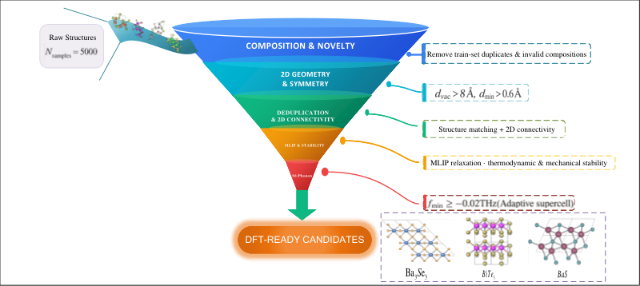

# DFCA: Diffusion Framework for Crystal Anisotropy

**An anisotropy-aware diffusion framework for two-dimensional crystal generation and screening.**

---

## Overview

DFCA generates stable, novel 2D crystal structures using a crystal-specific diffusion transformer architecture with explicit modeling of in-plane (XY) and out-of-plane (Z) anisotropy.

**Key innovation:** Direction-dependent noise scaling and dual-stream attention that separates periodic in-plane bonding from vacuum-dominated out-of-plane geometry.

---

## Architecture



**Core components:**
- **CrystalEmbedder**: XY linear + Z MLP with explicit separation
- **DualStream Cross-Attention**: Separate XY/Z streams with asymmetric gating
- **BondDecoupledMLP**: Independent XY/Z feature processing
- **18 DiT blocks** with adaLN modulation

Implementation: [`dfca/models/dit.py`](dfca/models/dit.py)

---

## Physics-Informed Training



11 physics constraints (c₁–c₁₁) as training loss terms:
- **Auxiliary**: invalid slots (c₁), atom count (c₂)
- **Chemical**: element validity (c₃), distribution (c₈), density (c₉)
- **Spatial**: slab centering (c₄), spread (c₅)
- **Lattice**: length (c₆), angle (c₇), vacuum floor/ceiling (c₁₀, c₁₁)

Implementation: [`dfca/training/constraints.py`](dfca/training/constraints.py)

---

## Generation Pipeline



Four-stage generation: Noise Seed → Guided Denoising → Atom Decode → Crystal Reconstruction

Implementation: [`dfca/diffusion/gaussian.py`](dfca/diffusion/gaussian.py)

---

## Benchmark Results

| Metric | CrystalDiT | DFCA | DiffCSP | DiffCSP++ | FlowMM |
|--------|------------|------|---------|-----------|--------|
| Structural Validity | 89.00% | 81.40% | **99.71%** | 100.00% | 93.85% |
| Compositional Validity | 71.80% | **100.00%** | 86.52% | 84.00% | 79.98% |
| 2D Validity | **98.60%** | 90.40% | 95.61% | 81.00% | 93.75% |
| Overall Validity | 63.00% | 73.60% | **82.91%** | 67.00% | 70.61% |
| Uniqueness | 99.68% | **100.00%** | **100.00%** | **100.00%** | **100.00%** |
| Novelty | 71.66% | **97.28%** | 81.86% | 44.78% | 78.98% |
| 2D-UN | 45.00% | **71.60%** | 67.87% | 30.00% | 55.76% |
| 2D DistScore | 0.800 | **0.908** | 0.766 | 0.739 | 0.701 |

DFCA achieves highest Compositional Validity, Novelty, 2D-UN, and 2D DistScore.

---

## Engineering Screening



5,000 generated structures → 49 candidates → **19 dynamically stable** via hierarchical screening.

Screening stages: S0 (composition) → S1 (geometry) → S2 (symmetry) → S3 (dedup) → S4 (MLIP relax) → S5 (energetics) → S6 (phonon) → DFT validation

See [`docs/screening.md`](docs/screening.md) for details.

---

## Representative Materials

Three representative candidates with diverse electronic properties:

| Material | Formula | Electronic Behavior |
|----------|---------|---------------------|
| BaS | BaS | Semiconducting |
| BaSe₃ | BaSe₃ | Narrow-gap semiconducting |
| Ag₂Se₅ | Ag₂Se₅ | Metallic |

Full 19-material results: [`docs/supplementary/materials_index.md`](docs/supplementary/materials_index.md)

---

## Installation

```bash
# ML environment
conda env create -f environment/environment-ml.yml
conda activate dfca

# DFT environment (for validation)
conda env create -f environment/environment-dft.yml
```

See [`docs/data.md`](docs/data.md) for dataset preparation.

---

## Training and Generation

### Training

```bash
PYTHONPATH=. python scripts/train.py \
    --config configs/train.yaml \
    --data_dir ./Data \
    --output_dir ./output
```

### Generation

```bash
PYTHONPATH=. python scripts/generate.py \
    --config configs/generate.yaml \
    --checkpoint /path/to/checkpoint \
    --output_dir ./candidates \
    --num_samples 100 \
    --device cuda
```

See [`docs/generation.md`](docs/generation.md) for details.

---

## Evaluation

```bash
PYTHONPATH=. python eval/run_2d_eval.py \
    --gen_dir ./candidates \
    --train_csv ./Data/train.csv \
    --output_dir ./eval_results
```

---

## Reproducibility

Configuration files: [`configs/`](configs/)

```bash
# Set random seed
python scripts/train.py --config configs/train.yaml --seed 42
```

See [`docs/randomness_and_reproducibility.md`](docs/randomness_and_reproducibility.md)

---

## Documentation

| Document | Description |
|----------|-------------|
| [`docs/method.md`](docs/method.md) | Scientific method |
| [`docs/training.md`](docs/training.md) | Training pipeline |
| [`docs/screening.md`](docs/screening.md) | Screening workflow |
| [`docs/dft_validation.md`](docs/dft_validation.md) | DFT validation |

---

## License

See [`LICENSE`](LICENSE)
